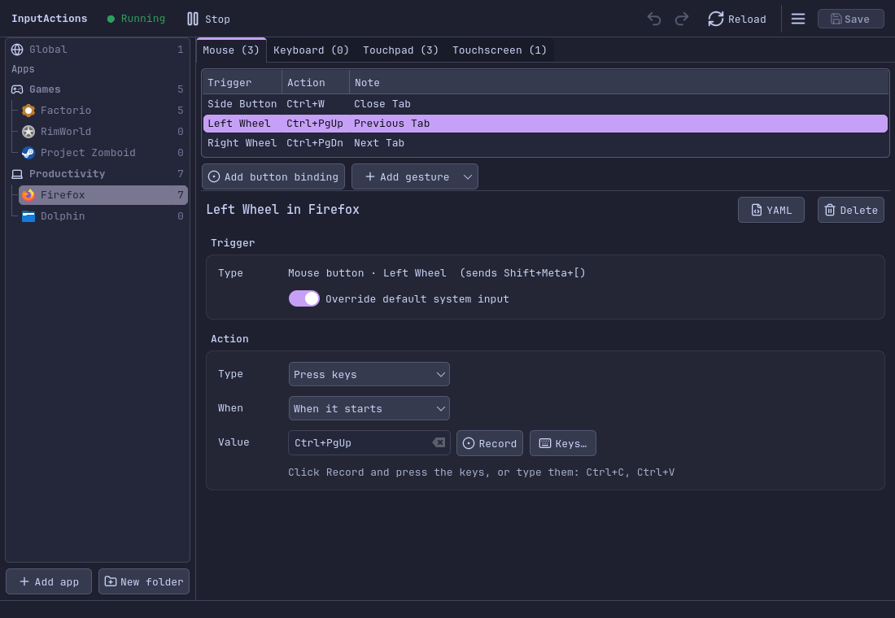
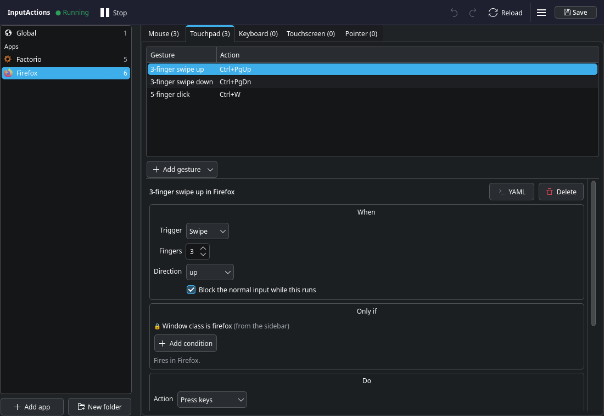
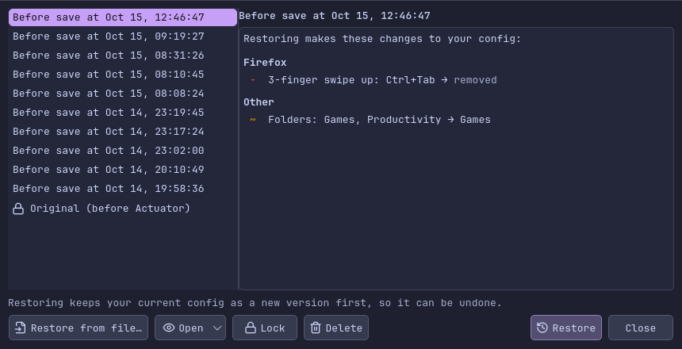
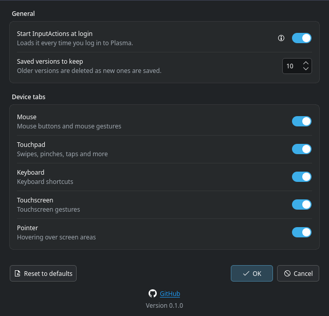

# Actuator

A desktop app for configuring [InputActions](https://wiki.inputactions.org/) on KDE Plasma — mouse
buttons, touchpad and touchscreen gestures, and the per-app actions they trigger — without editing YAML
by hand (unless you want to).



## Features

- **Per-app bindings.** Global bindings plus one page per app, organized into folders. Add apps from a
  searchable list of installed apps, or by clicking a window.
- **Mouse buttons and gestures.** Bind buttons (including ones that send key combos from the mouse's own
  software), swipes, pinches, strokes and more. Name your buttons.
- **Simple actions.** Press keys, hold keys, run a command, or trigger a Plasma shortcut. Record keys by
  pressing them, or pick them from a list.
- **Conditions.** Limit a binding to fullscreen windows, held modifier keys, a screen edge, and more
  (developer mode).
- **Safe saving.** Your config is checked before every write, a version is kept on every save, and the
  Restore window shows exactly what restoring a version would change. Undo and redo cover unsaved edits.
- **Copy and paste** bindings between apps, or copy an app's whole setup.
- **YAML when you want it.** View or edit any binding as YAML, or the whole file with live validation
  (developer mode).

## Screenshots

| Touchpad gestures | Restore a saved version | Options |
|---|---|---|
|  |  |  |

## Requirements

- KDE Plasma 6 with [InputActions](https://wiki.inputactions.org/main/getting-started/installation/index.html)
  (the KWin plugin and the `inputactions` command)
- Python 3.11+, PySide6, ruamel.yaml

On Arch-based systems:

```bash
sudo pacman -S --needed pyside6 python-ruamel-yaml
```

## Running

From a clone of this repository:

```bash
python3 -m actuator
```

To install the `actuator` command and add Actuator to your app launcher:

```bash
pipx install --system-site-packages .
install -Dm644 data/actuator.desktop ~/.local/share/applications/actuator.desktop
```

## How it works with your config

Actuator edits `~/.config/inputactions/config.yaml`, the file InputActions reads. Existing configs are
picked up as they are. The first time Actuator saves, it rewrites the file in a consistent, organized
layout and keeps your original as `config.yaml.original`.

- Button names, extra apps, folders and device types are stored as `# actuator:` comment lines at the
  top of the file, so a plain copy of the file is a complete backup.
- Other comments you write by hand aren't kept when Actuator rewrites the file.
- Saved versions are kept in `~/.local/share/actuator/snapshots/` (10 by default; change it in Options).
- If the file is edited elsewhere, Actuator reloads it. If it isn't valid YAML, Actuator shows the error
  and won't write to the file until it's fixed.

## Developer mode

Click the version number in Options ten times. Developer mode adds toggles for device settings
(swipe angles, thresholds, timeouts), the full YAML editor, the condition builder, and git auto-commit.

## Git auto-commit (developer mode)

Actuator can commit `config.yaml` to git every time it changes the file, and optionally push it, so your
setup is versioned and backed up. Turn it on in Options → Developer Options → Enable Git Auto-Commit, and
choose whether to push. Every change is committed, including folders, apps and button names, since those
are stored in the file too.

Actuator only commits `config.yaml`; anything else in the repository is left alone. Commit messages
describe the change, for example `Actuator: Firefox: ~ Meta+W: Ctrl+W → Ctrl+T`.

You set up the repository once yourself:

```bash
cd ~/.config/inputactions
git init
git add config.yaml
git commit -m "Initial InputActions config"
```

To push as well, create an empty repository on GitHub (or anywhere else), then:

```bash
git branch -M main
git remote add origin git@github.com:YOUR-NAME/inputactions-config.git
git push -u origin main
```

Pushing runs in the background without asking for a password, so it needs credentials that work on their
own: an SSH key added to your account, or a git credential helper. Options shows whether git, the
repository and the remote are set up.

## License

[MIT](LICENSE)
